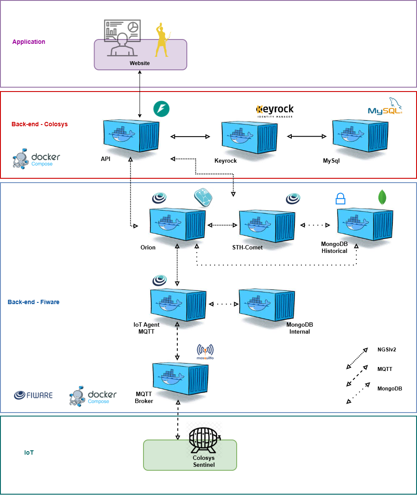

# Colosys Sentinel

O **Colosys Sentinel** é uma solução IoT para monitoramento ambiental. O sistema acompanha luminosidade, temperatura e umidade, permite configurar limites por dispositivo e sinaliza condições fora da faixa esperada por meio de comandos de controle e alertas no dispositivo.

O projeto é composto por uma interface web, uma API de aplicação integrada ao FIWARE e um dispositivo IoT físico ou simulado.

## Integrantes

| Integrante | RM |
|---|---|
| **Beatriz dos Santos Silva** | **RM573698** |
| **Gabriel Kenzo** | **RM569780** |
| **Lorenzo Mendes Pena** | **RM570036** |
| **Maria Clara Ramos Santini** | **RM573246** |
| **Murillo Perez da Fonseca** | **RM573674** |

## Vídeo de apresentação

## Repositórios e demonstração

- **Projeto principal:** [colosys-sentinel](https://github.com/MurilloFonseca/colosys-sentinel)
- **Front-end:** [colosys-lamp-client](https://github.com/MurilloFonseca/colosys-lamp-client)
- **Back-end:** [colosys-lamp-server](https://github.com/MurilloFonseca/colosys-lamp-server)
- **Simulação Wokwi:** [Abrir a simulação](https://wokwi.com/projects/465199340265498625)

## Componentes do sistema

| Componente | Responsabilidade |
|---|---|
| Front-end React + Vite | Interface para cadastro, visualização e configuração das lâmpadas/dispositivos. |
| Back-end FastAPI | API, autenticação, integração com FIWARE, histórico, eventos em tempo real e automação. |
| FIWARE Orion Context Broker | Mantém o contexto atual dos dispositivos. |
| FIWARE IoT Agent | Integra os dispositivos com o contexto FIWARE. |
| Keyrock + MySQL | Gerenciamento de identidade e autenticação de usuários. |
| STH-Comet | Armazena e disponibiliza o histórico de medições. |
| ESP32 / Wokwi | Dispositivo físico ou simulado que envia medições e recebe comandos. |

## Arquitetura

A imagem abaixo resume a arquitetura da solução. O diagrama editável está disponível em [`arquitetura.drawio`](./arquitetura.drawio).

O fluxo está organizado em camadas: dispositivo físico, plataforma FIWARE, plataforma API e aplicação web.

Fluxo geral:

1. O ESP32 envia as medições de luminosidade, temperatura e umidade pelo mecanismo de comunicação configurado para o dispositivo.
2. O IoT Agent integra as medições com o Orion Context Broker.
3. O back-end consulta o contexto atual e o histórico do STH-Comet.
4. A interface web consulta a API para apresentar os dispositivos, os valores atuais, o histórico e os limites configurados.
5. Ao receber novas leituras, o back-end publica eventos para a interface e executa a lógica de automação de acordo com os limites configurados.

> Os endereços e as redes Docker dependem do ambiente. Consulte o README do back-end antes de iniciar os serviços.

## Funcionalidades documentadas no código

- Cadastro, listagem e exclusão de dispositivos/lâmpadas.
- Cadastro e autenticação de usuários.
- Visualização de leituras atuais por fluxo de eventos em tempo real.
- Consulta de histórico de luminosidade, temperatura e umidade.
- Configuração de limites mínimos e máximos por parâmetro.
- Integração com Orion, IoT Agent e STH-Comet.
- Automação de comandos de acordo com as leituras e os limites definidos.

## Instalação e execução

A aplicação está dividida em repositórios independentes. Siga os guias específicos:

1. **[Instalar e executar o back-end](https://github.com/MurilloFonseca/colosys-lamp-server)** — inclui instruções para FIWARE no mesmo servidor (`master`) e FIWARE remoto (`deploy-local`).
2. **[Instalar e executar o front-end](https://github.com/MurilloFonseca/colosys-lamp-client)** — configure `VITE_API_URL` para apontar à API.
3. **[Testar a simulação Wokwi](https://wokwi.com/projects/465199340265498625)**.

### Front-end publicado

O front-end é publicado na Vercel. Configure a variável de ambiente `VITE_API_URL` nas configurações do projeto Vercel para usar a URL pública da API. O valor deve ser a origem da API, sem o sufixo `/api`, pois o cliente acrescenta esse caminho automaticamente.

## Modelo físico

O arquivo [`modelo/barril.stl`](./modelo/barril.stl) contém o modelo 3D do projeto físico. Ele pode ser aberto em um visualizador STL ou em um programa CAD compatível.

## Tecnologias

- React 19, Vite, React Router, Axios, Tailwind CSS e Plotly.js
- Python, FastAPI, Uvicorn, HTTPX e Pydantic
- FIWARE Orion Context Broker, IoT Agent e STH-Comet
- Keyrock e MySQL
- Docker Compose
- ESP32 e Wokwi

## Evidências e validação

Para demonstrar a solução, recomenda-se validar e registrar:

- Cadastro e autenticação de usuário.
- Cadastro e gerenciamento de um dispositivo.
- Atualização das leituras em tempo real.
- Consulta do histórico em gráficos.
- Alteração dos limites de temperatura, umidade e luminosidade.
- Comportamento dos comandos de automação com leituras dentro e fora dos limites.
- Funcionamento na simulação Wokwi e, quando disponível, no hardware físico.

## Observações

- Não coloque senhas, tokens ou outros segredos nos repositórios.
- Para execução remota, confirme que a API está acessível pelo navegador e que `CORS_ORIGINS` inclui a origem real do front-end.
- A API usa cookies de autenticação; HTTPS e a configuração de `COOKIE_SECURE` devem ser coerentes com o ambiente de publicação.
